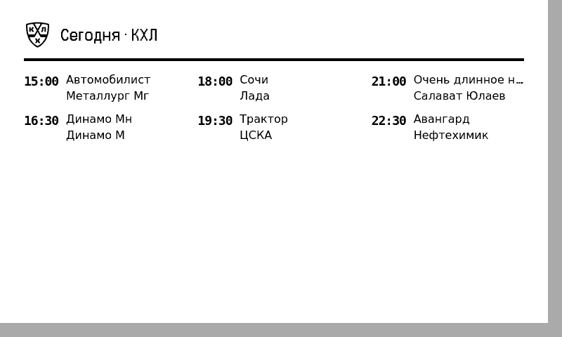
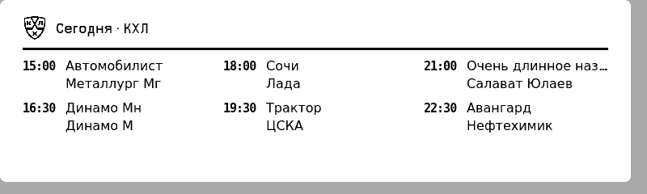
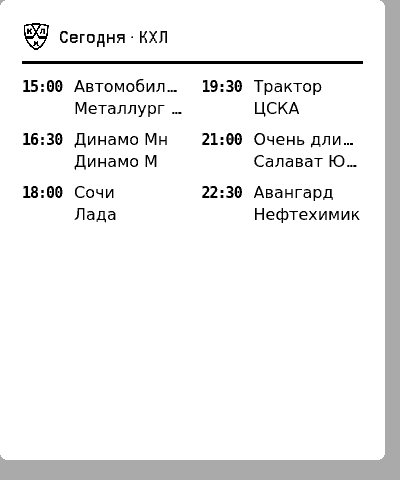
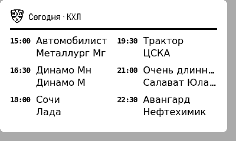

# Расписание КХЛ для TRMNL

Независимый рецепт [TRMNLP](https://github.com/usetrmnl/trmnlp), показывающий расписание Континентальной хоккейной лиги на e-ink-экране. Интерфейс, время и дата — только на русском и всегда в `Europe/Moscow`.

> Рецепт не связан с КХЛ, не одобрен лигой и не является официальным продуктом.



## Поведение

- Все матчи текущего московского дня остаются видимыми до полуночи.
- Если сегодня матчей нет, показывается полный ближайший игровой день.
- Если API вернул пустое расписание (например, в межсезонье), виджет показывает «Сезон завершен!» и приблизительное количество дней до ближайшего 1 сентября.
- Пустые ответы и ошибки показываются аккуратным русским сообщением без JSON и технических деталей.

| 800×240 | 400×480 | 400×240 |
| --- | --- | --- |
|  |  |  |

## Установка

1. Скачайте ZIP через **Code** на GitHub или из GitHub Release.
2. В TRMNL импортируйте архив как Private Plugin.
3. Добавьте плагин в плейлист или Mashup. Обновление уже задано раз в 15 минут.

После добавления в TRMNL Recipe Catalog рецепт можно будет установить прямо из каталога.

| Настройка | По умолчанию | Назначение |
| --- | --- | --- |
| `layout` | `auto` | Авто, компактный, стандартный или широкий макет. |
| `max_games` | `auto` | Авто либо 2, 3, 4 или 6 матчей; на четверти экрана авто выводит до 6. |
| `show_date` | включено | Показывать дату игрового дня. |

## Источник данных

Расписание берётся из reverse-engineered mobile API КХЛ: `https://khl.api.webcaster.pro/api/khl_mobile/events_v2.json`. Формат документирован в [shayypy/khl-api](https://github.com/shayypy/khl-api/blob/main/mobile-api.md).

Это внутренний API приложения, а не заявленный публичный API для сторонних разработчиков. Его доступность и формат не гарантированы. О проблемах сообщайте через [GitHub Issues](https://github.com/Aist/trmnl-khl/issues).

Polling TRMNLP ожидает JSON-объект, тогда как `events_v2.json` возвращает массив. Поэтому polling запускает Serverless через лёгкий `data.json`, а Serverless делает один запрос расписания с началом текущих московских суток. Запрос ограничен 4,5 секундами; ключи, личный сервер и proxy не нужны.

### Проверка production API

31 октября 2026 года выполнены 10 запросов с `locale=ru`, `order_direction=asc` и началом московских суток: 10 × HTTP 200, без ошибок, p50 — 0,720 с, p95 (nearest rank) — 1,067 с. Все ответы были валидными JSON-массивами по 16 записей и содержали `type_id: 24`, матч текущего дня и полный ближайший игровой день. Прямой путь укладывается в целевой пятисекундный бюджет, поэтому отдельный cache/proxy не нужен.

## Проверка локально

```sh
docker run --rm -e CI=true -v "$PWD":/plugin trmnl/trmnlp:latest test --report report
docker run --rm -v "$PWD":/plugin trmnl/trmnlp:latest lint
docker run --rm -v "$PWD":/plugin trmnl/trmnlp:latest build
```

Тесты покрывают матчи до/после старта, московскую полночь, пустой день, межсезонье, timeout, неожиданный JSON, размеры, переполнение и контраст.

## Лицензии и атрибуция

Собственный код распространяется по [MIT](LICENSE). `src/assets/khl-logo.svg` — логотип КХЛ 2026 года, правообладатель — Континентальная хоккейная лига, источник — [русская Википедия](https://ru.wikipedia.org/wiki/Файл:Логотип_КХЛ.svg). Файл помечен как несвободный и используется для идентификации лиги; в шапке применяется его встроенная PNG-копия, поэтому логотип не требует сети.
